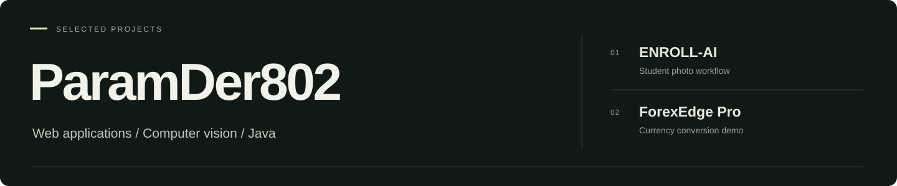

  

Two projects I’m working on: a browser-based student photo workflow and a Java currency converter.

## 01 / ENROLL-AI

Import a roster, capture photos with on-device quality checks, review each image, and export files named by enrollment number. The operator verifies the student; the model checks the frame.

**React · TypeScript · MediaPipe · IndexedDB**

AIML Group 3 project. Photos and records stay in the browser unless exported.

[Repository](https://github.com/ParamDer802/Enroll-AI) · [Screenshots](https://github.com/ParamDer802/Enroll-AI#see-the-app) · [Capture pipeline](https://github.com/ParamDer802/Enroll-AI/blob/main/docs/AI_PIPELINE.md)

## 02 / ForexEdge Pro

Convert between 15 currencies, adjust the markup, and compare the amount you receive. A small Java HTTP API handles validation, calculations, and saved conversions.

**Java · JavaScript · HTML/CSS · Python**

Simulated rates and session-only history. Automated checks run on Windows and Linux.

[Repository](https://github.com/ParamDer802/forexedge-pro) · [Screenshots](https://github.com/ParamDer802/forexedge-pro#preview) · [Run locally](https://github.com/ParamDer802/forexedge-pro#quick-start)

---

**Other work:** earlier business-website projects for Hind Group Upleta are in [my repositories](https://github.com/ParamDer802?tab=repositories).
